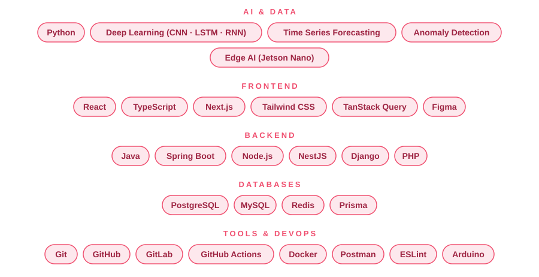

<picture>
    <source media="(prefers-color-scheme: dark)" srcset="images/banner-dark.svg">
    
  </picture>

<!-- Theme-Adaptive Logos -->
<picture>
  <source media="(prefers-color-scheme: dark)" srcset="images/Dark-Logo.png">
  <source media="(prefers-color-scheme: light)" srcset="images/Logo.png">
  
</picture>

 
 

<a href="https://github.com/HadjerL">
  <picture>
    <source media="(prefers-color-scheme: dark)" srcset="https://readme-typing-svg.demolab.com?font=Fira+Code&weight=500&size=22&pause=1200&center=true&vCenter=true&width=640&lines=Software+Engineer+%C3%97+AI+Engineer;Building+scalable+web+platforms;Deep+learning+on+the+edge+%F0%9F%A4%96;M2+AI+student+%40+UPEC&color=2DB5D0">
    
  </picture>
</a>

  

<a href="https://www.linkedin.com/in/hadjer-laissaoui-13a420255/">
  <picture>
    <source media="(prefers-color-scheme: dark)" srcset="https://img.shields.io/badge/LinkedIn-Hadjer%20Laissaoui-0088A0?style=for-the-badge&logo=linkedin&logoColor=white">
    
  </picture>
</a>
<a href="https://medium.com/@hadjerlais77">
  <picture>
    <source media="(prefers-color-scheme: dark)" srcset="https://img.shields.io/badge/Medium-@hadjerlais77-0088A0?style=for-the-badge&logo=medium&logoColor=white">
    
  </picture>
</a>
<a href="mailto:kh_laissaoui@esi.dz">
  <picture>
    <source media="(prefers-color-scheme: dark)" srcset="https://img.shields.io/badge/Email-kh__laissaoui@esi.dz-0088A0?style=for-the-badge&logo=gmail&logoColor=white">
    
  </picture>
</a>

---

## 👋 About Me

I'm a software engineer turning into an AI engineer. I like building **clean, scalable applications** and getting machine learning models out of notebooks and into real products.

- 🎓 Engineer from **ESI Algiers**, now in **Master 2 AI (IA2S)** at **Université Paris-Est Créteil**
- 🏗️ Building a **national library platform** (82k readers, 9k+ books) with **Spring Boot + React**
- 🔭 Looking for a **6-month AI / ML / Data Science internship starting March 2027** in France
- ✍️ I write about what I learn on [Medium](https://medium.com/@hadjerlais77)
- 🌍 Arabic · French · English

---

## 🧰 Tech Stack

  <picture>
    <source media="(prefers-color-scheme: dark)" srcset="images/stack-dark.svg">
    
  </picture>

---

## 🛠️ Featured Projects

<table>
  <tr>
    <td width="50%" valign="top">
      <h3>🌬️ Wind Turbine Predictive Maintenance</h3>
      Final-year project at CDER. CNN/LSTM/RNN models for fault classification and power forecasting on SCADA data, deployed on a <b>Jetson Nano</b> for real-time inference, with a dashboard and admin panel.  
      
      
      
    </td>
    <td width="50%" valign="top">
      <h3>📚 National Library Platform</h3>
      Digitization and modernization of a national library system. I built the <b>Spring Boot</b> backend for authentication, users, staff, guests and registration (140+ documented REST endpoints), plus the <b>React</b> back-office and public reader portal.  
      
      
      
    </td>
  </tr>
  <tr>
    <td width="50%" valign="top">
      <h3>🧩 BracePy Compiler</h3>
      A complete compiler for a C-like language: lexical, syntactic and semantic analysis, symbol table and quadruple generation. 
      👉 <a href="https://github.com/HadjerL/BracePy-compiler">View the code</a>  
      
      
    </td>
    <td width="50%" valign="top">
      <h3>🛒 Full-Stack E-Commerce Platform</h3>
      Complete online store: UI/UX design, backend, secure admin panel with roles and order tracking, and production deployment.  
      
      
    </td>
  </tr>
  <tr>
    <td width="50%" valign="top">
      <h3>🔌 QubeLink: IoT Smart Socket</h3>
      Remote-controlled socket over MQTT: ESP8266 + relay + AC–DC converter, custom circuit, 3D-printed enclosure, Arduino firmware and a React Native control app.  
      👉 <a href="https://github.com/HadjerL/sci-smart-switch">View the code</a>  
      
      
      
    </td>
    <td width="50%" valign="top">
      <h3>📱 Student Attendance App</h3>
      Mobile app that tracks attendance by scanning QR codes on student cards. Built with React Native, Node.js and MySQL, in an Agile workflow.  
      
      
      
    </td>
  </tr>
</table>

---

## 📊 GitHub Stats

<picture>
    <source media="(prefers-color-scheme: dark)" srcset="https://github-readme-stats.vercel.app/api?username=HadjerL&show_icons=true&theme=transparent&hide_border=true&count_private=true&title_color=2DB5D0&icon_color=2DB5D0&text_color=c9d1d9">
    
  </picture>
<picture>
    <source media="(prefers-color-scheme: dark)" srcset="https://github-readme-stats.vercel.app/api/top-langs/?username=HadjerL&layout=compact&theme=transparent&hide_border=true&title_color=2DB5D0&text_color=c9d1d9">
    
  </picture>

 

<picture>
    <source media="(prefers-color-scheme: dark)" srcset="https://streak-stats.demolab.com?user=HadjerL&theme=transparent&hide_border=true&ring=2DB5D0&fire=2DB5D0&currStreakLabel=2DB5D0&currStreakNum=c9d1d9&sideNums=c9d1d9&sideLabels=c9d1d9&dates=8b949e">
    
  </picture>

 

<picture>
    <source media="(prefers-color-scheme: dark)" srcset="https://github-readme-activity-graph.vercel.app/graph?username=HadjerL&hide_border=true&bg_color=0D1117&color=2DB5D0&line=2DB5D0&point=FFFFFF&area=true&area_color=2DB5D0&title_color=2DB5D0">
    
  </picture>

---

## ✍️ Writing

I share what I learn about software engineering and AI on **[Medium → @hadjerlais77](https://medium.com/@hadjerlais77)**.

---

## 🤝 Let's Connect

I'm open to internships, collaborations and interesting projects. If you're building something exciting, I'd love to hear about it.

📫 [kh_laissaoui@esi.dz](mailto:kh_laissaoui@esi.dz) · 🔗 [LinkedIn](https://www.linkedin.com/in/hadjer-laissaoui-13a420255/) · ✍️ [Medium](https://medium.com/@hadjerlais77)

 

<picture>
  <source media="(prefers-color-scheme: dark)" srcset="https://komarev.com/ghpvc/?username=HadjerL&label=Profile+Views&style=for-the-badge&labelColor=555555&color=0088A0">
  
</picture>

 

<picture>
    <source media="(prefers-color-scheme: dark)" srcset="images/footer-dark.svg">
    
  </picture>

